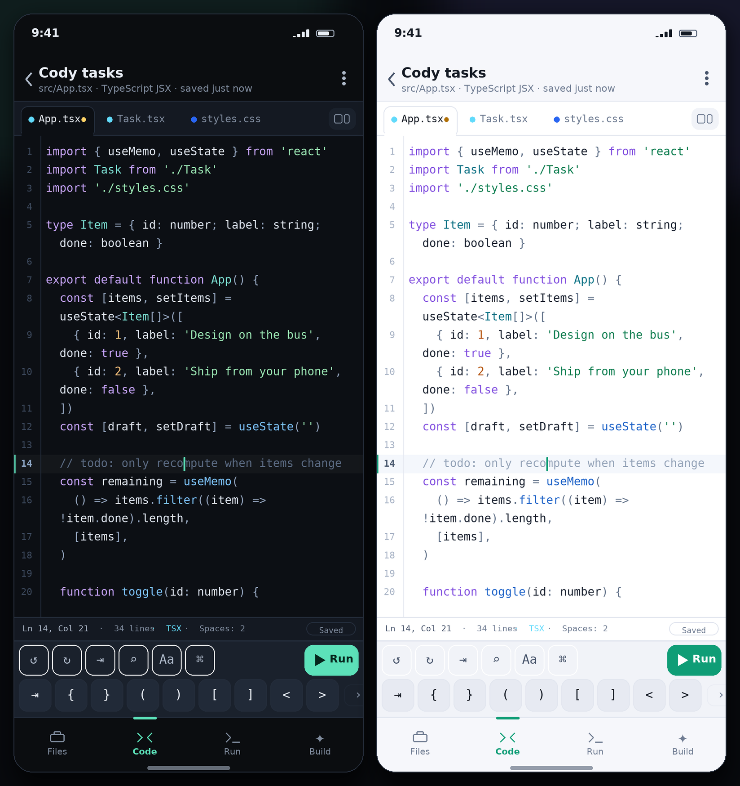

# Cody

**A mobile-first, multi-language project editor — build entire software projects from your phone.**

Cody is a complete coding environment that fits in a phone browser (and installs as a PWA).
It gives you a file tree, a fast touch-friendly code editor, live previews that bundle in the
browser, real Python in the browser, a cloud sandbox for compiled languages, and one-tap export
of a runnable project.

**It opens as an editor, not a landing page.** Cold start drops you straight into a workspace with
the code on screen — no hero, no marketing, no empty dashboard. Workspaces, templates, imports and
settings live in a switcher sheet one tap (or `⌘K` / `Ctrl+K`) away, and the app remembers the
workspace you were in.

No backend. No install step. No account. Projects are stored on the device (IndexedDB) and
nothing leaves it unless you explicitly run a cloud-sandbox language.



---

## Why it exists

Desktop editors assume a keyboard and three panes of screen. Cody assumes a thumb:

- **Editor first** — boot lands in the code, not a dashboard. The workspace switcher is a sheet
  over the editor, so switching projects never costs you your screen.
- **One-handed navigation** — a 4-tab bottom bar (Files · Code · Run · Build) instead of a
  cramped sidebar, with every primary action inside the bottom third of the screen.
- **A keyboard for people without a keyboard** — a symbol rail (`{} () [] => ; $`) plus
  language-aware insert keys (`def `, `fn `, `useState(` …), undo/redo, comment toggle, find.
- **Previews that actually run your code** — Cody transpiles TypeScript/JSX with Sucrase and
  resolves imports to blob modules inside a generated HTML shell, so `import App from './App'`
  works with no bundler server.
- **Polyglot or nothing** — 28 languages highlight out of the box; browser languages, Python and
  cloud languages each take an appropriate execution path.
- **Never lose work** — autosave on every pause, offline app shell, ZIP / JSON export, backup all.

---

## Features

### Editing
- CodeMirror 6 editor tuned for touch: line wrapping by default, no iOS zoom (16px+ inputs),
  indent / outdent / comment / undo / redo / find in a persistent toolbar.
- Editor chrome modelled on the best phone editors (Spck, Acode) and then tightened:
  **file tabs**, a quiet **line-number gutter** with the active line highlighted, a
  **status strip** (`Ln 14, Col 21 · 34 lines · TSX · Spaces: 2 · Saved`) and a two-row
  **keyboard rail** — actions with a pinned Run on top, a scrollable symbol row below, docked
  against the OS keyboard instead of floating over your code.
- Lazy-loaded grammars for **28 languages** (JavaScript, TypeScript, TSX/JSX, HTML, CSS, JSON,
  Markdown, Python, SQL, XML/SVG, YAML, TOML, Shell, C, C++, Java, C#, Go, Rust, PHP, Ruby, Lua,
  Swift, Kotlin, Dockerfile, Diff, plain text).
- Live theme (dark/light), font size 11–22px, tab size, line numbers, mono/serif, haptics.
- Autocomplete, bracket matching, bracket closing, multi-cursor, search panel, fold-aware editing.

### Workspaces & files
- First launch creates a runnable scratch workspace (HTML + CSS + JS) and opens `index.html`.
- Workspace switcher (header chevron or `⌘K`): open, create, duplicate, delete, import, theme,
  settings — all as sheets over the editor.
- Templates: Web app, React + TypeScript, Python, Node API, C, Go, Rust, Java, Three.js, blank.
- File tree with folders, search, rename/move, duplicate, delete, "set as entry".
- Import loose files (multi-select), import a whole folder (`webkitdirectory`), or import a
  `.cody.json` project file.
- Export a **ZIP** (dependency-free ZIP writer, no libraries) or a portable JSON project, and use
  the native share sheet where the browser supports `navigator.share` with files.

### Running
| Runtime | Languages | How |
| --- | --- | --- |
| Browser preview | HTML/CSS/JS, TS/TSX/JSX, SVG, React, Three.js | Sucrase transpile + import map + blob modules in an `iframe srcdoc` |
| Python | `.py` | Pyodide (CPython → WASM) in a Web Worker, streamed stdout/stderr |
| Cloud sandbox | C, C++, Java, Go, Rust, PHP, Ruby, Lua, Swift, Kotlin, C#, SQL, Shell | Piston-compatible API (`Settings → Runner`), configurable endpoint |
| Not runnable | JSON, YAML, Markdown, Dockerfile… | Edited and exported only |

- **Console bridge**: `console.log/warn/error`, uncaught errors and unhandled rejections from the
  preview are piped into Cody's console panel with timestamps and source tags.
- Cloud runs support **stdin** and show compile errors separately from runtime output.
- Opt-in **auto re-run** rebuilds the preview shortly after you stop typing.
- Configurable runner endpoint + a "Test" button that lists available runtimes.

### Mobile / PWA
- Installable (manifest + icons + service worker), `100dvh` layout, safe-area padding for the
  notch and home indicator, sticky header, bottom sheets instead of modals, toast feedback.
- Offline: the app shell and assets are cached; all project data is local.
- Responsive: single column on phones, wider centred column with side borders on tablets/desktop.

### Build assist ("Build" tab)
- Curated, offline snippet library (20 snippets) filtered by the language of the file you are
  editing — insert at the cursor or scaffold a new file.
- Project health at a glance: file/language/runnable counts and each language's runtime.

---

## Editor design notes

The screen is organized around one rule: **the code gets the middle of the phone**. Every
reference I looked at (Spck Editor, Acode, Dribbble code-editor kits) does this, and each one
loses something to get there — usually the line numbers, the caret position, or the file you are in.

| Layer | Height | What it does |
| --- | --- | --- |
| Header | 52px | Workspace name, `file · language · saved just now`, run + menu |
| File tabs | 38px | Active/recent files, language dot, unsaved dot, close, all-files button |
| Editor | flexible | Wrapped code, gutter, active-line highlight, caret + selection colours |
| Status strip | 26px | `Ln/Col`, selection size, lines, size, language, tab size, save state |
| Keyboard rail | 85px | Row 1: undo/redo/indent/find/text/keys/hide-keyboard + pinned **Run**; Row 2: scrollable symbol keys |
| Tab bar | 62px + safe area | Files · Code · Run · Build |

Details that matter on a phone:

- **Symbols where your thumb already is.** A touch keyboard hides `{}`, `[]`, `<>`, `=>`, `;` and
  backticks; the rail is a keyboard extension, not a toolbar. Long rails scroll with a fade so it
  is obvious there is more.
- **Two rows, not one.** Six action icons plus keys in a single row left room for three symbols on
  a 390px screen (see the mock's history); splitting rows gives ~5 actions and 9 symbols at once.
- **The caret is a first-class feature.** `Ln/Col` updates live, the active line gets a hairline
  accent bar, and the gutter number for that line brightens — you always know where you are.
- **Quiet gutter.** Line numbers are off-white/dim and only the active one is bold, so dense code
  reads first and chrome reads second.
- **One accent colour.** Mint marks the active tab underline, the active line bar, Run, and the
  selected tab in the bar. Everything else is neutral, so state jumps out.
- **Keyboard-aware.** When the OS keyboard opens, `visualViewport` height is measured and the rail
  docks to it (sticky) rather than being pushed off-screen. The ⌄ key dismisses the keyboard.
- **Both themes are real.** Dark and light are separate palettes for chrome *and* syntax, including
  selection, search matches, bracket matching and the autocomplete popup.

Regenerate the mock with `python3 scripts/render-mock.py docs/cody-editor.png` (reads the live
tokens from `src/styles.css` and `src/editor/theme.ts`). It is a design renderer, not a browser
screenshot — this sandbox has no Chromium.

---

## Getting started

```bash
npm install
npm run dev          # http://localhost:5173 (also bound to 0.0.0.0)
```

Production:

```bash
npm run build        # typecheck + vite build → dist/
npm run preview
```

Quality checks:

```bash
npm run typecheck    # strict TypeScript
npm test             # bundler checks, SSR of every screen, jsdom app smoke test
```

Open Cody on a phone on the same network, or add it to your home screen for the standalone
app experience.

---

## Deployment

Cody is a static Vite build, so it deploys anywhere that serves files.

**Vercel** — this repo is connected to the Vercel project `cody`:

| | |
| --- | --- |
| Production | https://cody-flux-cf70.vercel.app |
| Branch alias | https://cody-git-arena-e151acae-cody-flux-cf70.vercel.app |

`vercel.json` pins the framework (Vite), build command (`npm run build`), output directory
(`dist`) and long-lived caching for `/assets/*` (the service worker is kept revalidating so PWA
updates land immediately).

Any other host works the same way: `npm run build` and serve `dist/`, giving the app a single-page
fallback to `index.html`. To install it on a phone, open the deployment URL and use
**Add to Home Screen** — the manifest and icons are already wired up.

## Architecture

```
src/
  App.tsx                  app shell: routing, state, persistence, run orchestration
  components/
    ProjectSwitcher.tsx    workspace list, new-from-template, import, theme/settings
    ProjectView.tsx        header, tab bar, project menu & sheets
    FilesPane.tsx          file tree, search, file actions
    CodePane.tsx           editor host + mobile toolbars/sheets
    RunPanel.tsx           entry picker, preview iframe, console, stdin
    CodyPanel.tsx          offline snippet library & project stats
    SettingsSheet.tsx      appearance, preview, runner, data
    Sheet.tsx              bottom-sheet primitive (+ PromptSheet)
  editor/
    CodeEditor.tsx         CodeMirror 6 wrapper with imperative handle
    theme.ts               dark/light editor themes + syntax palettes
  lib/
    bundle.ts              in-browser bundler (specifier rewrite, HTML inlining, import map)
    python.ts/.worker.ts   Pyodide worker bridge
    cloud.ts               Piston client + runner health check
    storage.ts             IndexedDB (localStorage fallback) persistence
    languages.ts           28-language registry + lazy CodeMirror grammars
    templates.ts           project templates
    snippets.ts            snippet library
    importExport.ts        ZIP / JSON import-export, share
    zip.ts                 minimal ZIP writer (store + CRC32)
    utils.ts               small shared helpers
```

### How the in-browser bundler works

1. Pick an entry file (`project.entry`, an `index.html`/`src/main.tsx` heuristic, or the file you
   tapped).
2. For an HTML entry: inline local `<link rel=stylesheet>` and classic `<script src>` tags, map
   local `<script type=module src>` tags to blob URLs, inline referenced images/SVG as data URLs,
   and inject the console bridge.
3. For a JS/TS entry: transpile with Sucrase (`typescript`, `jsx`, automatic JSX runtime),
   rewrite relative imports to `https://cody.local/<path>` (resolved against the file map with
   extension/index guesses), send bare imports to esm.sh, and register every module as a blob URL
   in a generated `<script type="importmap">`.
4. The shell HTML is rendered into an `iframe srcdoc`; anything the project logs is forwarded to
   Cody's console via `postMessage`.

This means React, Three.js and any esm.sh-compatible package work with zero install — and any
relative import you add to the project resolves without configuration.

---

## Privacy & data

- Projects, settings and the last-open project live in IndexedDB on your device (with a
  localStorage fallback), including "backup all" → one JSON file.
- Browser previews run locally. React/Three.js templates fetch their packages from `esm.sh`,
  Python fetches Pyodide from `jsDelivr`, and cloud-sandbox languages send the single entry file to
  the configured Piston endpoint (public by default; point it at your own in Settings).

## Known limits

- Previews use blob modules, so a project file that is *only* imported dynamically by a URL string
  built at runtime won't resolve.
- Cloud runs send one file (the entry). Multi-file compiled builds belong on a desktop or in a
  container.
- The public Piston endpoint rate-limits; run your own instance for heavy use.
- Pyodide needs ~10 MB on first Python run (cached afterwards).

## Roadmap ideas

- Split editor view for tablets (files + code side by side)
- Diff view for imported files, git export as a commit-ready patch
- Optional GitHub sign-in to push a project as a repository
- Multi-file cloud runs via a container runner
